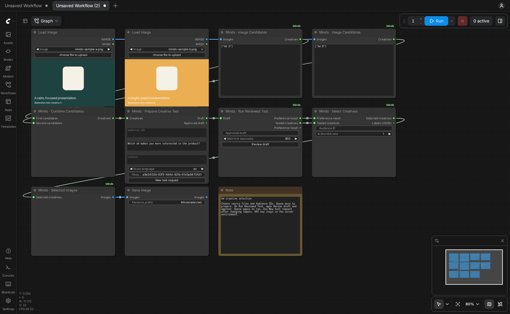

# Minds for ComfyUI: image and video preference testing

The official [Minds](https://getminds.ai) integration adds audience preference testing to [ComfyUI](https://www.comfy.org/). **Minds · Audience Preferences** compares image, video and concept alternatives with your selected Minds Audiences. Its ordinary node fields collect your question and inputs; the embedded Minds response widget shows the completed research. Selected original media can continue directly to Save, upscaling or video nodes.



This workflow-only capture replays a completed live integration test with two published Coca-Cola campaign images. Ad B (Share a Coke) received 4 of 5 selections (80%); Ad A (football) received 1 (20%). The five-Mind QA Audience verifies the integration path, not campaign performance. Sources: [football campaign](https://www.coca-colacompany.com/media-center/coca-cola-invites-gen-z-to-live-fully-in-the-moment) and [Share a Coke](https://www.coca-colacompany.com/media-center/iconic-share-a-coke-is-back-for-a-new-generation.html).


This integration uses the existing Minds Study API and its current model routing. It does not select or deploy a Mosaic checkpoint.

## Install

Find **comfyui-minds** by publisher **minds** in the [Comfy Registry](https://registry.comfy.org/nodes/comfyui-minds). Check the Registry version's verification status before installation. The [GitHub release](https://github.com/minds-ai-co/ComfyUI-Minds/releases/tag/v0.2.2) is available for direct installation.


Clone `https://github.com/minds-ai-co/ComfyUI-Minds` into your ComfyUI `custom_nodes/ComfyUI-Minds` directory. Install `requirements.txt` using **the same Python interpreter ComfyUI uses**, then restart ComfyUI. The pack uses ComfyUI's existing PyTorch installation.

Provide `MINDS_API_KEY` in the ComfyUI server process's environment using your credential manager. Create or manage that key in Minds. Credentials stay on the machine running ComfyUI. This integration is intended for your own server, not a shared service with unrelated users. Never put a key into a node field, URL or workflow JSON.

In Browse Templates, look for **ComfyUI-Minds**. Copy the illustrative files from `example_workflows/assets` into ComfyUI's `input` folder, or choose your own media. Each template contains one Minds research node. **Minds · Find Audiences** remains an optional helper for reading accessible Audience IDs and readiness; its offset pages beyond 100 Audiences.

## Review and run

1. Connect images or videos directly to the matching sockets. Connecting the last available image or video socket reveals another, so four separate videos or images can feed one comparison without a batching helper. Existing `IMAGE` batches and Comfy lists also work. All images precede all videos in candidate order, with sockets ordered first, second, third, and so on. These media inputs are optional when supplying hosted assets or concepts.
2. Leave `labels_json` blank for automatic labels (`Creative 1`, `Creative 2`, …). To name the alternatives yourself, supply one unique label per native candidate in that order; for four inputs, for example, use `["Original", "Revision", "Story", "Product demo"]`. Saved workflows with explicit two-candidate labels keep those labels: clear the field to use automatic labels when adding more candidates. `assets_json` supplies additional hosted files or authored concepts; their own labels follow the native candidates.
3. Enter existing `audience_ids`, comma-separated, and your preference question, context and Study language. Queue once. Read the exact question, alternatives and selected Audiences in the review dialog, then click **Approve this draft**. Preparation does not run research; downstream nodes stay blocked until approval.
4. Queue again. The same node runs the approved draft and shows the actual Minds response interface: preference distributions, findings and available individual Mind responses. Place the pointer over the results and use the mouse wheel or a two-finger trackpad gesture to scroll to the findings and bottom controls. The graph stays in place. The taller documentation capture shows the complete result at once; ordinary node results remain scrollable. The `results_json` and `preference_result` outputs provide the ranking for automation.
5. Connect `selected_images` or `selected_videos` directly downstream. They emit lists of original native media, preserving video audio and supporting images with different dimensions. With multiple Audiences, results always stay separate; enter a matching `selection_audience_id` to enable downstream selection. Leaving it blank shows all Audience results and blocks selection. `top_k` controls the shortlist size.

Equal preference shares remain ties, including ties at the shortlist boundary; more than `top_k` items may be returned. An absent native modality blocks only that media output. Hosted files and concepts are retained in `selected_creatives`, but cannot produce a native IMAGE/VIDEO output without the original objects.

Use **New test request** after changing media, labels, question, context, language or Audiences. The node manages its request ID and approval fingerprint internally. Retain the saved workflow and ComfyUI receipts to resume a timeout or restart. Retrying the same approved request reuses its durable Study/run. Changing only the shortlist size or selection Audience reuses the completed research.

### Compare four videos or images

1. Open `08-four-image-selection.json` or `09-four-video-selection.json` from Browse Templates → ComfyUI-Minds.
2. Choose your own different file in each of the four Load nodes. The included sample files are repeated placeholders to make the template loadable, not four distinct creatives.
3. Enter your Audience IDs and comparison question. Leave `labels_json` blank; the four inputs become `Creative 1` through `Creative 4`.
4. Click **New test request**, queue once, check all four alternatives in the draft and approve it.
5. Queue again to run one comparison. Read the four preference shares inside the Minds node; the selected original continues to Save.

For a fifth alternative, connect it to the new empty socket. Images and videos can also be mixed in the same comparison. The total remains 2–20 candidates, including every item in connected batches/lists and any hosted assets or concepts.

## Hosted files and concepts

`assets_json` accepts labelled HTTPS image/video files:

```json
[
  {"label": "Video A", "url": "https://your-host.example/video-a.mp4", "mimeType": "video/mp4"},
  {"label": "Video B", "url": "https://your-host.example/video-b.mp4", "mimeType": "video/mp4"}
]
```

Or authored text concepts:

```json
[
  {"label": "Demonstration", "text": "Show the product being used in one continuous shot."},
  {"label": "Story", "text": "A customer explains the problem and demonstrates the solution."}
]
```

Hosted files are imported into durable Minds account storage by the API; private-network destinations are refused there. Text concepts test the supplied words, rather than a finished video. The same preference test and Audience selection apply to every supported input.

## Limits and meaning

Compare 2–20 alternatives per question. Locally encoded files use the existing 50 MB multipart upload limit; hosted imports use the API's 100 MB limit. The complete question, context and creative references must fit the existing 2,000-character fixed-question limit; content is never silently shortened. A native VIDEO is uploaded as MP4 including its audio. The API enforces account access, Audience readiness, plan and usage limits.

Shares come from the API's exact categorical distribution, retaining fractional expected counts and zero-count alternatives. No confidence interval is invented. These are estimated preferences among supplied alternatives, rather than measured clicks, conversions or sales. Partial, failed, cancelled or media-incomplete research never selects winners.

Private retry receipts under ComfyUI's user directory (`minds/receipts`) contain only account-scoped identifiers, hashes and run references. They contain no keys, signed download URLs or answer bodies. Workflow JSON contains your questions, asset references, Audience IDs and approval fingerprint; inspect it before sharing. ComfyUI's execution history also retains result data as it does for other output nodes.

For headless use, queue `MindsPreference` with a UUID `request_id` and blank `reviewed_draft`. Inspect `outputs.<nodeId>.minds_review[0]` in Comfy history. After approval, set `reviewed_draft` to that review's exact `approval` and queue the same inputs/request again. Completed history contains `minds_response[0]` for the widget; graph outputs contain ranking JSON and native media.

The older multi-node identifiers remain loadable as deprecated compatibility nodes. New workflows use the single node. Registry verification status and GitHub release availability are separate; check the Registry version status before assuming Manager verification.


## Common questions

### What does Minds add to a ComfyUI workflow?

Minds estimates how your selected AI-powered Audiences prefer the alternatives you supply. Use it for ad creative testing, thumbnails, packaging designs, video concepts, or an original-versus-revision comparison. Each Audience receives its own result; the node does not combine different populations into one winner.

### Can I test generated videos, including audio?

Yes. Connect native ComfyUI VIDEO objects to the node, or supply labelled HTTPS video assets. Native videos are uploaded as MP4 with audio, and selected originals continue downstream with their audio. The published integration was tested end to end with two short video fixtures; long-video acceptance has not been established by those smoke tests.

### Is it one ComfyUI node?

Yes. Minds · Audience Preferences collects the inputs, prepares a reviewable Study draft, runs it after approval, displays the response widget, and returns native media and ranking outputs. Optional helper nodes remain available for Audience lookup and compatibility with older workflows.

### Which inputs and results does the node support?

Inputs include native IMAGE batches, native VIDEO objects, hosted image/video files and authored text concepts. Compare 2–20 uniquely labelled alternatives with one preference question. Results include a separate preference distribution for each selected Audience, findings and available Mind responses in the embedded widget, ranking JSON, and original selected native media.

### Do these results predict actual ad clicks or sales?

They estimate synthetic preference among the tested alternatives. Click-through rate, conversions, sales and real campaign performance are not measured by this node. The five-Mind demo runs verify the integration, rather than serving as model-accuracy or campaign-performance evidence.

### Do I need to put my Minds API key in the workflow?

No. The ComfyUI server reads its key from the credential manager's environment injection. Normal input widgets, shared workflows and the embedded response widget contain no API key. You also need an existing Minds account and ready Audiences with access to the Study API.

### How is this related to Mosaic?

This release calls the existing Minds Study API and its current model routing. It does not install a Mosaic model checkpoint or expose a model selector. Video input support is part of the integration's tested API workflow.

### Where are the source code, examples and support?

The [source repository](https://github.com/minds-ai-co/ComfyUI-Minds), [nine example workflows](https://github.com/minds-ai-co/ComfyUI-Minds/tree/main/example_workflows), [verification record](qa.md), and [issue tracker](https://github.com/minds-ai-co/ComfyUI-Minds/issues) provide installation details, reproducible examples and support. The [Minds API documentation](https://getminds.ai/docs/api) covers the research platform behind the node.
